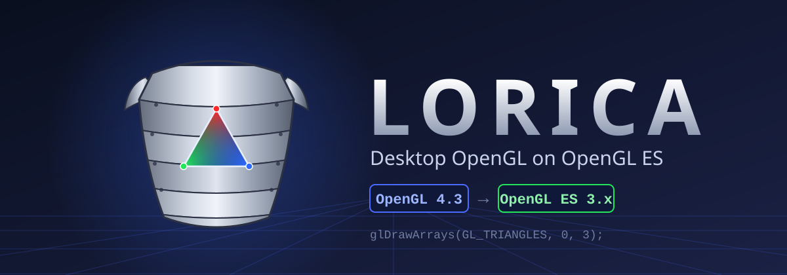

**Run desktop OpenGL applications on GPUs that only speak OpenGL ES.**

---

## What Lorica is

Lorica sits between an application that speaks desktop OpenGL and a GPU
that only speaks OpenGL ES. The application makes normal GL calls;
Lorica translates them on the fly.

Its core translation engine descends from an MIT-licensed project by
Sebastien Chevalier and Ryan Hileman (see [Legal](#legal)). Everything on
top of that core -- the version negotiation, the modern-GL layer, the GLX
bridge, the DSA shim -- was written for Lorica, with one goal: run the
Gladiator stack well, and be easy to reshape.

## What it does

- **GLSL translation.** Shaders written for desktop GLSL 1.10 through
  4.60 are rewritten to the highest GLSL ES the backend accepts
  (300 es / 310 es / 320 es). Precision qualifiers are injected,
  removed features are stubbed or rejected with a clear error.
- **Dispatch.** Every GL entry point goes through a lookup table.
  Apps that resolve symbols with `glXGetProcAddress` get the same
  functions as apps that link directly.
- **Version negotiation.** `glGetString(GL_VERSION)` and the
  `GL_MAJOR_VERSION` / `GL_MINOR_VERSION` queries report the version
  the context asked for, capped by what the backend can support.
  Legacy contexts get 2.1. Core contexts get whatever they requested,
  up to 4.3.
- **Modern GL layer.** Compute, SSBO, tessellation, transform feedback
  objects, program pipelines, texture views, `glCopyImageSubData`,
  multi-bind, indirect draws, base instance, DSA -- all forwarded to
  ES 3.1 / 3.2, with fallbacks where ES cannot express them.
- **GLX.** `glXCreateContext`, `glXCreateContextAttribsARB`,
  `glXMakeCurrent`, `glXSwapBuffers`, `glXGetProcAddress`,
  `glXChooseFBConfig`, `glXGetVisualFromFBConfig`. Enough for SDL 2,
  GLFW, and anything else that talks to X11.

## How it is organized

    src/
      gl/              core translator: FPE, lists, textures,
                       framebuffers, shaders, state, queries...
      gl/GLADIATOR/    the modern layer: GL 3.1 -> 4.3, DSA (4.5 ext),
                       compute, tess, transform feedback, sync, VAO,
                       shader link, GLSL conversion, capability probing
      glx/             GLX front-end, dispatch table, X11 plumbing
      egl/             EGL wrapper (EGL on top of GLX), see "EGL and GLX"
    include/           public headers
    TEST/              LoriTest.c, the single test program
    scripts/           termux-install.sh (build, verify, install, test)
    spec/              scripts that generate the extension tables
    documentación/     full documentation (implemented, not implemented,
                       limitations, known bugs, EGL/GLX)

The `GLADIATOR/` directory is the entry point for anything the core
does not cover. Files named `gl31_*` there implement the 3.x/4.x
surface. What is implemented, what is not, and the known limits are
documented in [`documentación/`](documentación/00-indice.md).

## Supported versions

| Version | Backend required | GLSL announced | Notes |
|---|---|---|---|
| 2.1 | ES 2.0 | 1.20 | Legacy default. |
| 3.1 | ES 3.0 | 1.40 | |
| 3.2 / 3.3 | ES 3.2 or geometry shader extension | 1.50 / 3.30 | |
| 4.0 - 4.2 | ES 3.1 (compute, images) + tessellation | 4.00 - 4.20 | |
| 4.3 | + texture view, copy image, multisample 2D array | 4.30 | |

The ceiling is set per process with `LIBGL_GL=<version>` (for example
`LIBGL_GL=33` or `LIBGL_GL=43`), or at runtime through
`gl31_set_max_version()`. Legacy contexts always get 2.1 regardless of
the ceiling.

`ARB_direct_state_access` is exposed when the announced version is 3.3
or higher, so applications that gate DSA on the extension string see it.

## Verified

End-to-end on a Mali-G52 MC2 through the Gladiator stack (bionic
`scutumd` shim, glibc `libEGL.so`), with a backend that reports ES 3.2:

- Core context sweep `3.1, 3.2, 3.3, 4.0, 4.1, 4.2, 4.3` -- all create,
  draw (`glClear` + `glReadPixels`), swap, then transition
  core -> legacy -> core -> destroy -> new core without breaking.
- Legacy context inside the same process still reports 2.1.
- Real applications: Red Eclipse 1.6, Luanti 5.10, SuperTuxKart, running
  through Scutum with Lorica loaded where the app requests modern GL.

The test program is `TEST/LoriTest.c`. On Termux the installer builds
and runs it for you:

    bash scripts/termux-install.sh

or, by hand, against the built library:

    gcc TEST/LoriTest.c -o loritest -Iinclude -Llib -l:libGL.so.1 -lX11 -lm
    LD_LIBRARY_PATH=lib LIBGL_GL=43 ./loritest --test

A passing run prints `RESULTADO: TODO OK`.

## What it does not do

GLES cannot express a few desktop-GL features. Those are the honest
limits:

- **No `glClipControl`.** ES has no equivalent.
- **No bindless, no sparse residency.**
- **No `glTextureBarrier`** on the current path.
- **64-bit double precision is downgraded to float.**
- **Cube map compressed subimage and getters** return
  `GL_INVALID_OPERATION` in some DSA paths.
- **Viewport / scissor / depth range arrays** only index 0
  (`GL_MAX_VIEWPORTS = 1`).
- **Transform feedback object getters**, `glGetnUniform*`, and
  `glGetVertexArrayIndexed64iv` are not implemented.

`documentación/03-no-implementado-y-limitaciones.md` lists each of these
against the affected function.

## Building

    mkdir -p build && cd build
    cmake .. -DCMAKE_BUILD_TYPE=Release -DNOX11=OFF -DNOEGL=OFF -DSTATICLIB=OFF -DGBM=OFF
    make -j4

The resulting shared library lands in `lib/libGL.so.1`. `NOX11=OFF`
enables the GLX front-end; `NOEGL=OFF` enables EGL; `GBM=OFF` skips
DRM.

## EGL and GLX

Lorica touches EGL and GLX in two opposite directions:

- **GLX on top of EGL (`libGL.so.1`).** The GLX front-end that
  applications link against is implemented with the *real* EGL of the
  device: `glXChooseFBConfig` becomes `eglChooseConfig`,
  `glXCreateContext*` becomes `eglCreateContext`, `glXMakeCurrent`
  creates the EGL surface, `glXSwapBuffers` becomes `eglSwapBuffers`
  (or a pbuffer copy to the X window, depending on `LIBGL_FB`).
- **EGL on top of GLX (`libEGL.so.1`, optional).** Built with
  `-DEGL_WRAPPER=ON`, an EGL library that implements the EGL API with
  Lorica's own `glX*` calls, for programs that ask for desktop OpenGL
  through EGL (`EGL_OPENGL_API`). An `EGLDisplay` is an X11 `Display*`,
  an `EGLConfig` is a `GLXFBConfig`, an `EGLContext` is a `GLXContext`.

Both paths are described in detail in
[`documentación/05-egl-glx.md`](documentación/05-egl-glx.md).

## Project goals

Lorica aims at **compatibility and correctness**: making desktop OpenGL
applications run, and being honest about what GLES cannot express. It is
not a performance project, and performance is not measured or tracked in
this repository.

## Gladiator integration

Inside Gladiator, Lorica is installed as `libGL.so.1` in
`/usr/lib/aarch64-linux-gnu`. The GLX front-end dispatches to EGL at
runtime, and EGL is the Scutum shim, which talks to `scutumd` and from
there to the Mali driver.

Nothing is linked against Scutum at build time. The binding is resolved
by the dynamic loader through `LD_LIBRARY_PATH`. `LIBGL_GL` selects the
version ceiling per application.

## Legal

Lorica is distributed under the **GNU General Public License v3.0**
(see [LICENSE](LICENSE)).

Portions derived from earlier work remain under their original
**MIT License**; the required copyright and permission notice is in
[NOTICE/LICENSE-MIT.txt](NOTICE/LICENSE-MIT.txt).

*OpenGL and OpenGL ES are trademarks of their respective owners. Lorica
is an independent project and is not affiliated with or endorsed by
Khronos.*
